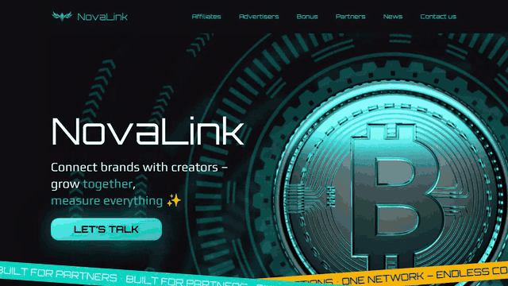
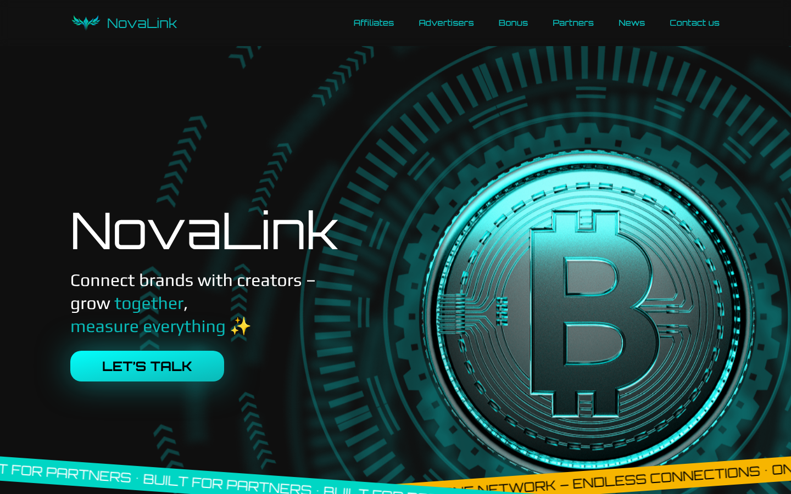
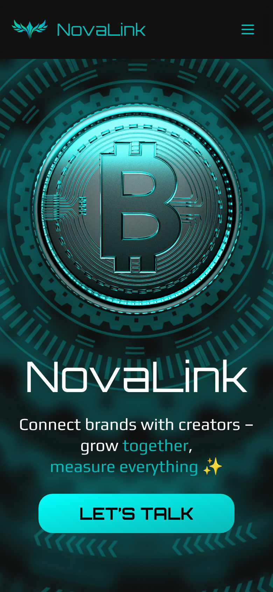
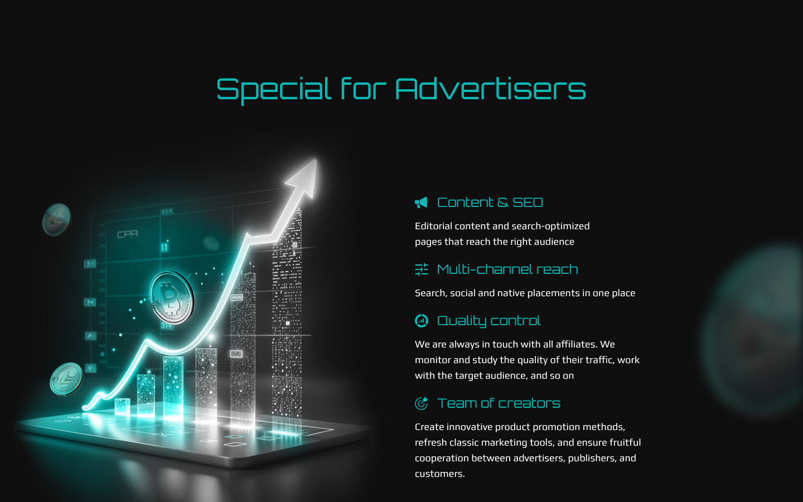
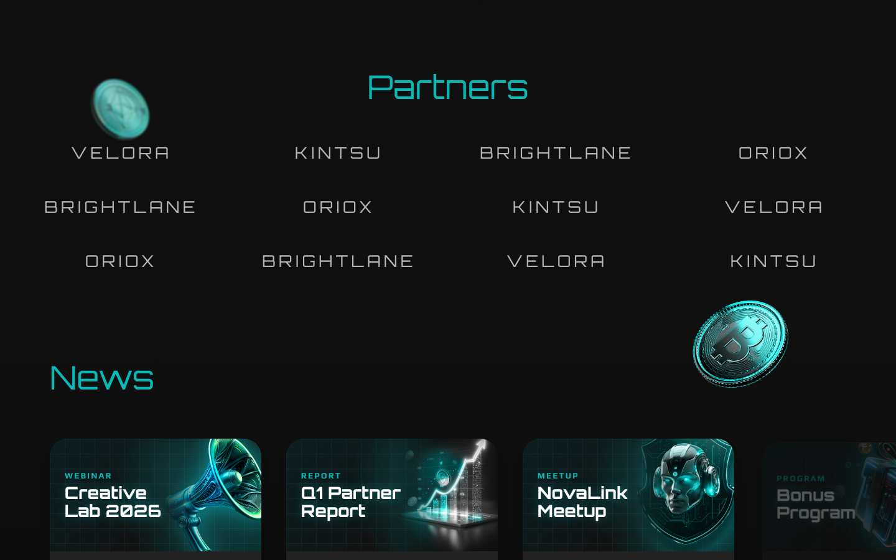
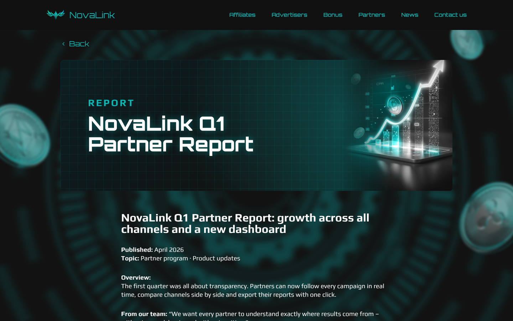

# NovaLink – Landingpage mit Animationen

Responsive Landingpage für ein (fiktives) Partner-Netzwerk im Bereich digitales Marketing.
Fokus des Projekts: **visuelles Design, Animationen und sauberes, responsives Layout**.

> ℹ️ Ursprünglich als Kundenprojekt umgesetzt. Für das Portfolio anonymisiert:
> Markenname, Texte, Partner-Logos und News sind **fiktiv**.

**Stack:** HTML5 · Tailwind CSS 4 · daisyUI 5 (eigenes Theme) · Vanilla JavaScript · Swiper.js



| Desktop | Mobile |
|---|---|
|  |  |
|  | |
|  | |
|  | |

## Umsetzung

- **Animationen mit reinem CSS:** rotierende Hintergrund-Ringe in verschiedenen Geschwindigkeiten
  und Richtungen, zwei gegenläufige Laufbänder (Marquee), pulsierende Akzente, Glow- und Hover-Effekte
- **News-Slider** mit Swiper.js (automatische Slide-Breite, Navigation)
- **Smooth Scrolling** zu den Sektionen über `data-scroll-to`, inklusive Header-Offset
- **Mobile Navigation** mit Burger-Menü
- **Kontaktformular** mit Umschalter „Affiliate / Advertiser“ (nur Frontend, kein Backend)
- **Eigenes daisyUI-Theme** mit Markenfarben, Typografie mit Orbitron und Play
- Unterseiten für **News-Artikel** und **Terms**
- Responsive von 390 px bis Desktop

## Struktur

```
index.html          Landingpage
news/news1.html     News-Artikel
terms/terms.html    Nutzungsbedingungen
input.css           Tailwind/daisyUI-Quelle (inkl. Theme)
output.css          kompiliertes CSS
images/             Illustrationen und Icons
```

## Lokal ansehen

`index.html` im Browser öffnen, ein Build ist nicht nötig.

CSS nach Änderungen neu bauen:

```bash
npm install -D tailwindcss @tailwindcss/cli daisyui
npx @tailwindcss/cli -i input.css -o output.css --watch
```
